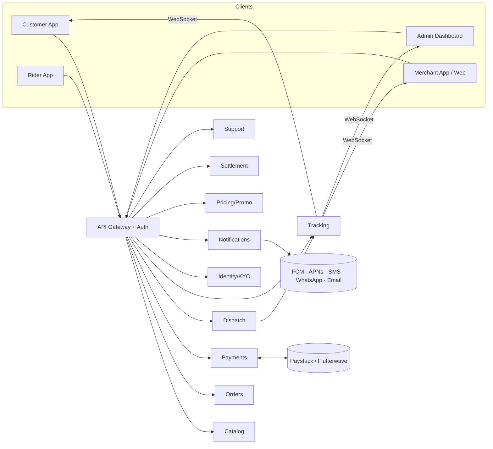
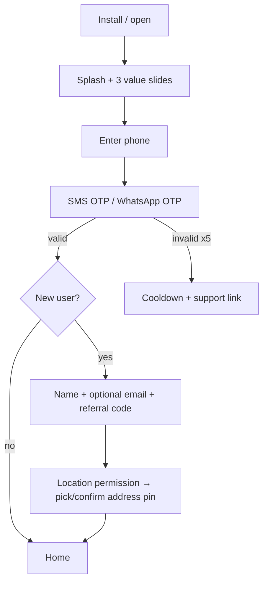
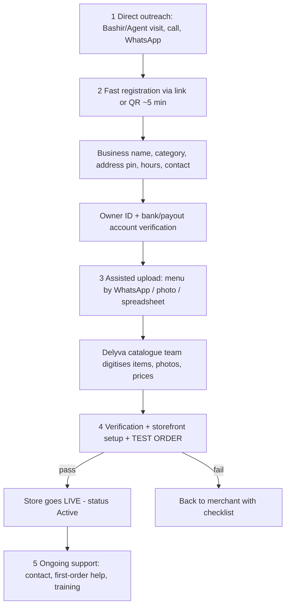
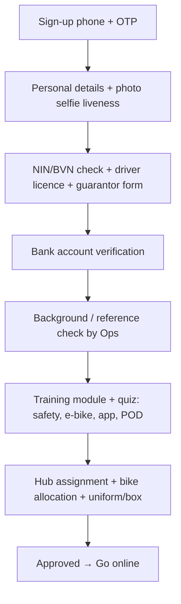
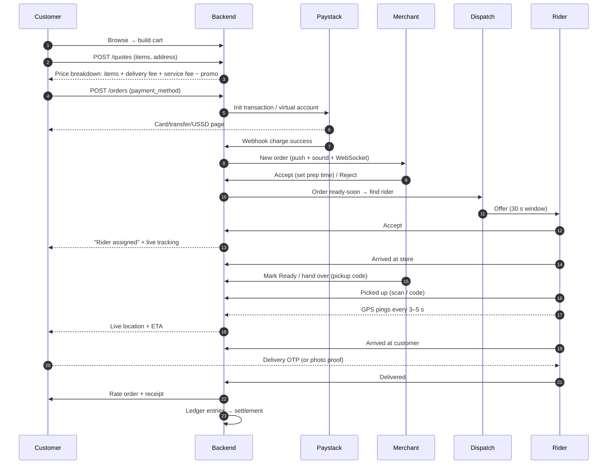
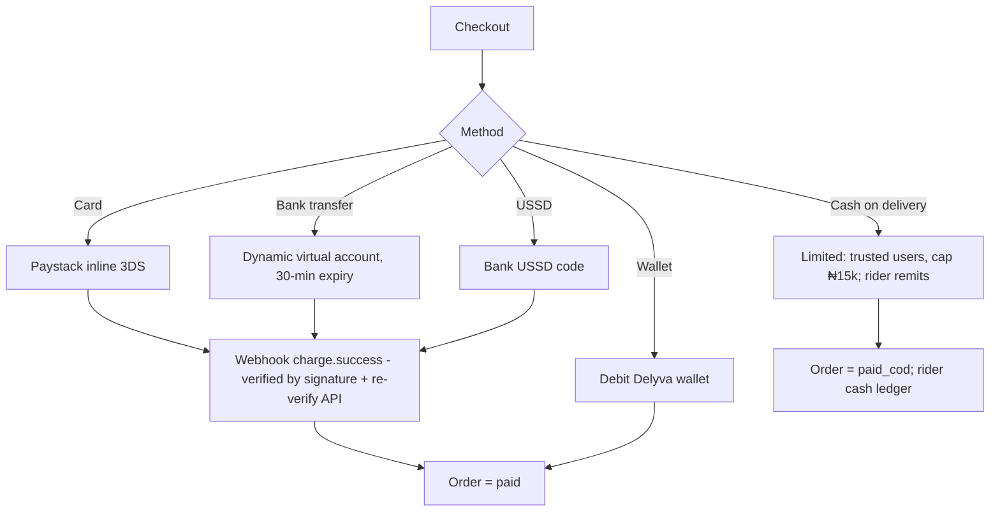
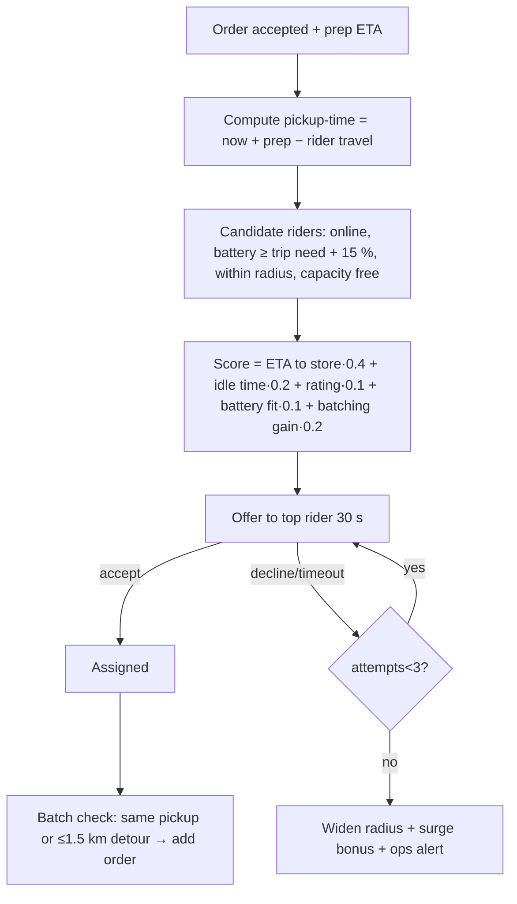
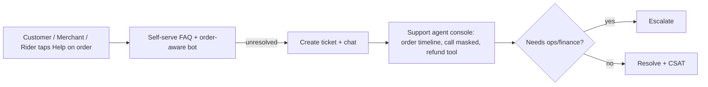
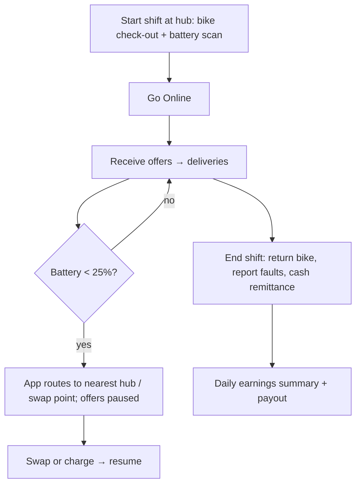

# 02 · System Flows & Workflows (end to end)

Actors: **C** Customer · **M** Merchant · **R** Rider · **O** Ops/Admin · **S** System (backend) · **P** Payment provider · **N** Notification channels (push/SMS/WhatsApp/email).

## 0. Big picture



## 1. Onboarding flows

### 1.1 Customer onboarding



Rules: phone is identity; OTP 6 digits, 5-min TTL, 5 attempts, resend after 30 s; device fingerprint stored; guest browsing allowed, login required at checkout.

### 1.2 Merchant onboarding (matches proposal's 5 steps)



States: `draft → submitted → in_review → approved → test_order → live` (also `suspended`, `rejected`). Tiering: micro-vendor (ID + bank only) vs registered business (CAC + food-safety cert where required).

### 1.3 Rider onboarding



States: `applied → docs_pending → under_review → training → approved → active` (+ `suspended`, `offboarded`).

### 1.4 Admin / ops onboarding

Super-admin invites by email → SSO/2FA required → role assigned (Ops, Support, Finance, Catalogue, Fleet, Super) → audit logging on every action.

## 2. Order lifecycle (master flow)



### 2.1 Order state machine

```
created ─► awaiting_payment ─► paid ─► merchant_pending ─► accepted ─► preparing ─► ready_for_pickup
   │              │               │            │                                        │
   ▼              ▼               ▼            ▼                                        ▼
cancelled      expired        refunded     rejected(→refund)           rider_assigned ─► rider_at_store ─► picked_up
                                                                                                             │
                                                              failed_delivery ◄─ at_customer ◄─ in_transit ◄─┘
                                                                     │                │
                                                                     ▼                ▼
                                                              returned_to_merchant  delivered ─► completed
```

Timeouts: merchant must accept in **3 min** (auto-reject → re-offer/refund); payment 15 min; rider offer 30 s, ×3 then widen radius; customer no-show wait 5 min → call → failed_delivery policy.

### 2.2 Order types

| Type                     | Difference                                                                                                                                               |
| ------------------------ | -------------------------------------------------------------------------------------------------------------------------------------------------------- |
| Food                     | Merchant accept + prep time, hot-food SLA, batching only if same-direction & <5 min detour                                                               |
| Grocery                  | Substitutions flow (customer approves swaps), weight/size surcharge                                                                                      |
| Parcel                   | No merchant. Sender enters pickup + drop, package size/value/category (permitted-items check), pickup OTP + delivery OTP, optional insurance             |
| Delivery-only (merchant) | Merchant books rider for off-platform order; customer gets tracking link by SMS/WhatsApp, no app required; merchant pays fee from wallet or per-delivery |

## 3. Payment flows



Safety: idempotency keys, webhook signature verification, amount re-check, duplicate-webhook safe, reconciliation job every 15 min.

### 3.1 Ledger (double-entry)

On `delivered`:

```
Customer pays 7,150   =  items 6,000 + delivery 450 + service 100 + VAT/other 600(if any)
 Dr  Paystack clearing         7,150
   Cr Merchant payable          5,280   (6,000 − 12% commission)
   Cr Rider payable               300
   Cr Delyva revenue (commission)  720
   Cr Delyva revenue (delivery margin) 150
   Cr Delyva revenue (service fee)  100
   Cr Tax payable                 600
```

Every money movement is a ledger entry (immutable); balances are derived.

### 3.2 Settlement

- **Merchant:** daily T+1 or weekly; statement PDF; negative balance carry-forward for refunds.
- **Rider:** instant cash-out (fee) or weekly free; COD remittance netted off.
- Payout via Paystack Transfers / Flutterwave Disburse; failed transfer → retry → ops queue.

## 4. Dispatch flow



Ops can **manual-assign / reassign** from admin map at any state.

## 5. Tracking flow

- Rider app sends `location` every 3–5 s (adaptive; batches offline, replays on reconnect).
- Backend → Redis geo index → WebSocket channel `order:{id}` → customer/merchant/admin.
- ETA recalculated from routing engine + live traffic every 30 s; push when "5 min away".
- Fallbacks: if socket drops → polling every 10 s; tracking link (no-login) via SMS/WhatsApp.
- Privacy: customer sees rider first name, photo, bike plate, **masked call/chat**; location only visible during active order.

## 6. Proof of delivery

1. Rider "Arrived" (geofence 80 m check, warn if outside).
2. Customer shows 4-digit **delivery OTP** → rider enters.
3. Fallback: photo at door + reason (customer unreachable) → ops review.
4. Parcel: pickup OTP at sender + delivery OTP at receiver; optional signature.
5. Fraud: OTP mismatch ×3 → ops call.

## 7. Cancellation, failure & refund

| Scenario                                                          | Outcome                                                                                               |
| ----------------------------------------------------------------- | ----------------------------------------------------------------------------------------------------- |
| Customer cancels before merchant accepts                          | Full refund                                                                                           |
| After accept / preparing                                          | Partial or no refund (merchant cost), policy config                                                   |
| Merchant rejects / times out                                      | Full refund + apology credit                                                                          |
| Rider can't be found 10 min                                       | Auto-cancel option + refund + credit                                                                  |
| Customer no-show                                                  | Wait 5 min → call ×2 → return/forfeit; fee charged                                                    |
| Wrong/missing item                                                | In-app report within 2 h with photo → support → refund to wallet/original method; merchant chargeback |
| Rider accident/bike fault                                         | Reassign, hub support dispatch, customer notified, compensation credit                                |
| Refund destination: wallet instantly, or original method (T+3–7). |

## 8. Support & disputes



SLA: first response < 3 min live chat, resolution < 24 h.

## 9. Rider shift & energy flow



Fleet module tracks: bike ID, battery SoC/health, charge cycles, maintenance schedule, hub solar generation vs consumption, grid fallback.

## 10. Merchant daily flow

Open store (toggle) → receive order alert → accept + prep time → prepare → mark ready → hand to rider (pickup code) → view earnings → handle out-of-stock (toggle item) → weekly payout/statement. Delivery-only: tap "Request Rider" → enter pickup/drop/package → pay from wallet → track.

## 11. Admin operations loop

Live board (orders by state, late orders in red) → intervene (reassign/cancel/refund/call) → approve merchants/riders → manage pricing & promos → review fraud flags → run settlements → monitor fleet/solar → reports/exports.

## 12. Notification matrix

| Event                                                        | Customer     | Merchant      | Rider    | Ops   |
| ------------------------------------------------------------ | ------------ | ------------- | -------- | ----- |
| Order paid                                                   | push         | push+sound+WS | –        | –     |
| Accepted                                                     | push         | –             | –        | –     |
| Rider assigned                                               | push+SMS     | push          | offer    | –     |
| Picked up                                                    | push         | –             | –        | –     |
| 5 min away                                                   | push         | –             | –        | –     |
| Delivered                                                    | push+receipt | push          | earnings | –     |
| Late > SLA                                                   | push apology | push          | nudge    | alert |
| Payout sent                                                  | –            | SMS/email     | push     | –     |
| Channels degrade: push → SMS → WhatsApp for critical events. |
