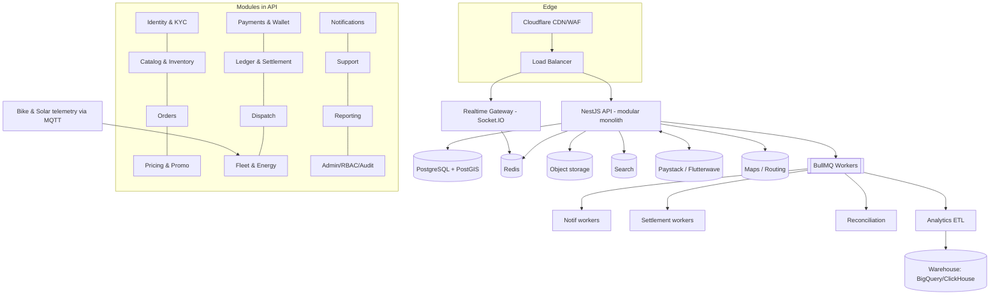

# 03 · System Architecture

## 1. Principles
- **Modular monolith first, services later.** One deployable (NestJS) with strict module boundaries → extract Dispatch/Tracking when load demands. Avoids microservice tax for a 3-person product team.
- **Event-driven core:** order state changes emit domain events (outbox pattern) consumed by notifications, ledger, analytics.
- **Mobile-first, low-bandwidth, offline-tolerant** (Nigeria).
- **Money is a ledger.** Integer kobo, double-entry, idempotent.
- **Everything observable & auditable.**

## 2. Recommended stack
| Layer | Choice | Why |
|---|---|---|
| Customer / Merchant / Rider apps | **React Native (Expo) + TypeScript** (one codebase, 3 app variants via flavors) | Speed, shared UI kit, OTA updates |
| Admin + Merchant web | **Next.js + TypeScript + Tailwind + shadcn/ui** | Desktop dashboards, SSR, shared tokens |
| Backend API | **NestJS (Node, TS)** REST + OpenAPI; WebSocket gateway | Team-friendly, typed contracts |
| DB | **PostgreSQL + PostGIS** | Relational + geo queries |
| Cache / geo / queues | **Redis** (GEO, pub/sub, BullMQ) | Rider positions, locks, jobs |
| Search | **Meilisearch / OpenSearch** | Merchant & dish search, typo tolerance |
| Realtime | WebSocket (Socket.IO) + Redis adapter; SSE fallback | Live tracking |
| Maps/Routing | Google Maps Platform (start) → **OSRM/Valhalla self-host + Mapbox** when cost matters | Cost control |
| Payments | **Paystack** (primary), **Flutterwave** (fallback) | NG coverage |
| Notifications | FCM/APNs, **Termii / Africa's Talking** SMS, WhatsApp Business API, SendGrid/Resend | OTP & fallback |
| Storage/CDN | S3-compatible + Cloudflare CDN + image resizing (imgproxy) | Light images |
| Infra | **AWS** (af-south-1 Cape Town) or Hetzner+Cloudflare for cost; Docker, Terraform, GitHub Actions | |
| Observability | Sentry, OpenTelemetry → Grafana/Prometheus/Loki, PostHog | |
| IoT (later) | MQTT broker for bike/battery/solar telemetry | Fleet module |

## 3. Logical architecture



## 4. Core modules (responsibilities)
| Module | Responsibilities |
|---|---|
| Identity & KYC | OTP login, JWT (15 min) + refresh (30 d, rotating), devices, roles, KYC providers (Smile ID / Dojah / Prembly for NIN/BVN), liveness |
| Catalog | Merchants, branches, menus, categories, modifiers, stock, availability, hours, media |
| Orders | Cart, quote, create, state machine, timeline, substitutions, cancellations |
| Pricing & Promo | Distance bands, surge, batching discount, vouchers, referrals, merchant campaigns |
| Payments & Wallet | Init/verify, webhooks, virtual accounts, refunds, wallet top-up, COD |
| Ledger & Settlement | Double-entry, commission, payout batches, statements, reconciliation |
| Dispatch | Candidate search, scoring, offers, batching, reassign, SLA monitor |
| Tracking | Location ingestion, geofences, ETA, route polyline, socket channels |
| Fleet & Energy | Bikes, batteries, hubs, charging sessions, maintenance, solar telemetry |
| Notifications | Templates, channel routing, preferences, retries, i18n |
| Support | Tickets, chat, macros, refund tool, CSAT |
| Admin | RBAC, audit log, config/feature flags, reports |

## 5. Dispatch engine (detail)
1. **Trigger:** on `merchant.accepted` with `prep_eta`. Schedule dispatch at `prep_eta − rider_travel_eta − 2 min` (avoids rider waiting).
2. **Candidates:** Redis `GEORADIUS riders:online lng lat 3km` → filter (status=online, not on max load, battery fit, verified, not blocked).
3. **Score** (weights configurable): ETA 40 %, idle time 20 %, rating 10 %, battery fit 10 %, batching gain 20 %.
4. **Offer:** push + socket to top-1 (or top-3 broadcast in dense zones); 30 s; exclusive lock via Redis `SET NX`.
5. **Batching:** allow stack of up to 2–3 orders if sum detour ≤ 1.5 km / +8 min and food-temp SLA safe.
6. **Fallbacks:** widen radius ×1.5 per round, add bonus, alert ops after 3 rounds.
7. **Later:** ML ETA, demand forecasting for hub staffing, VRP optimiser (OR-Tools) for multi-stop.

## 6. Realtime & tracking design
- Rider app → `POST /riders/me/locations` (batch) or WS `loc` event. Server validates speed/jitter, snaps to road, writes Redis GEO + last-known, appends to TimescaleDB/partitioned table for audit (sampled every 15 s).
- Channels: `order:{id}` (customer, merchant, assigned rider), `zone:{id}` (admin map), `rider:{id}` (offers).
- Message types: `order.status`, `rider.location`, `eta.update`, `chat.message`.
- Backpressure: throttle client updates to 1/3 s; compress; delta-encode.
- Scale: sticky-less via Redis adapter; ~10k concurrent sockets per node.

## 7. Payments design
- Provider abstraction `PaymentProvider { initiate, verify, refund, createVirtualAccount, transfer }`.
- **Never trust the client.** Mark paid only after verified webhook + server-side verify call.
- Idempotency-Key header on all mutating calls; webhook dedupe by provider reference.
- Reconcile job: compare provider settlements vs ledger every 15 min; mismatches → ops queue.
- Store no card data (PCI scope = SAQ-A via hosted fields).

## 8. Security & compliance
- TLS everywhere, HSTS; JWT short-lived; refresh rotation; device binding for riders.
- RBAC (+ ABAC by hub/city) for admin; 2FA mandatory; immutable audit log.
- Rate-limit OTP/login (IP + phone + device); bot protection on signup; OTP SIM-swap risk flags.
- PII encryption at rest (KYC docs in separate bucket with KMS, signed URLs, 30-day access logs).
- NDPA compliance: consent, data-subject requests, retention policy, DPO.
- Fraud: promo abuse (device/phone/address graph), fake orders, GPS spoofing detection (mock-location flag, speed jumps), COD limits, rider collusion alerts.
- OWASP ASVS L2, dependency scanning, secrets in vault, pen-test before launch.

## 9. Environments & infra
```
local (docker-compose) → dev (preview per PR) → staging (prod-like, sandbox PSP) → production
```
- IaC: Terraform; containers on ECS Fargate / k8s (later); managed Postgres (multi-AZ), Redis cluster.
- Backups: PITR 7 d, daily snapshots 30 d, quarterly restore drill.
- DR: RPO 5 min / RTO 1 h target.
- Cost control: image CDN, route caching, self-hosted routing at scale, spot workers.

## 10. Non-functional targets
| Metric | Target |
|---|---|
| API p95 | < 300 ms |
| Order create → merchant notified | < 3 s |
| Location update → customer screen | < 2 s |
| Availability | 99.9 % |
| App cold start | < 2.5 s on mid Android |
| App size | < 40 MB |
| Offline | Rider can finish current delivery offline; queue syncs |

## 11. Observability
Structured logs with `order_id` correlation; dashboards: orders/min, dispatch latency, offer acceptance, webhook lag, payout failures; alerts via PagerDuty/Slack; business alerts (late-order spike, merchant rejection spike).

## 12. Extensibility hooks
Feature flags (per city/hub), config-driven pricing & commission, plug-in vertical types (`order_type`), multi-city tenancy (`city_id` on all aggregates), public API + webhooks for merchant integrations (later), partner POS integrations.
