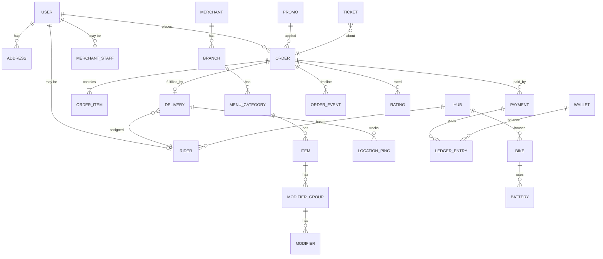

# 04 · Data Model & API

## 1. ERD (core)



## 2. Key tables (Postgres; all with `id uuid`, `created_at`, `updated_at`, `city_id`)

```sql
users(id, phone UNIQUE, name, email, role_flags, status, referral_code, referred_by, device_ids[], last_login)
addresses(id, user_id, label, line1, landmark, geo geography(Point), notes, is_default)
merchants(id, owner_id, name, category, logo, cover, status, commission_bps, kyc_tier, payout_account_id, rating_avg)
branches(id, merchant_id, name, geo, address, hours jsonb, prep_time_min, is_open, delivery_radius_m)
menu_categories(id, branch_id, name, sort)
items(id, category_id, name, desc, price_kobo, image, is_available, stock_qty, tags[], allergens[], sort)
modifier_groups(id, item_id, name, min, max) ; modifiers(id, group_id, name, price_kobo)
orders(id, code, type enum(food,grocery,parcel,delivery_only), customer_id, branch_id, status,
       subtotal_kobo, delivery_fee_kobo, service_fee_kobo, discount_kobo, tax_kobo, total_kobo,
       pickup jsonb, dropoff jsonb, notes, scheduled_for, promo_id, payment_method, placed_at, delivered_at)
order_items(id, order_id, item_id, name_snapshot, qty, unit_price_kobo, modifiers jsonb, note)
order_events(id, order_id, type, actor_type, actor_id, payload jsonb, at)       -- immutable timeline
deliveries(id, order_id, rider_id, status, pickup_otp, dropoff_otp, distance_m, eta_s, batch_id, proof_photo, assigned_at, picked_at, delivered_at)
dispatch_offers(id, delivery_id, rider_id, status enum(sent,accepted,declined,expired), sent_at, responded_at, score)
riders(id, user_id, hub_id, kyc_status, status, vehicle_id, rating_avg, acceptance_rate, cash_balance_kobo)
location_pings(delivery_id, rider_id, geo, speed, battery_pct, at)   -- partitioned by day
payments(id, order_id, provider, reference UNIQUE, method, amount_kobo, status, raw jsonb)
wallets(id, owner_type, owner_id, balance_kobo)                         -- derived cache
ledger_entries(id, txn_id, account, debit_kobo, credit_kobo, ref_type, ref_id, at) -- append-only
payouts(id, owner_type, owner_id, amount_kobo, status, provider_ref, period_start, period_end)
promos(id, code, type, value, min_order, cap, starts, ends, usage_limit, per_user_limit, audience jsonb)
hubs(id, name, geo, solar_kw, battery_kwh, status) ; bikes(id, hub_id, plate, model, status, odo_km)
batteries(id, bike_id, soh_pct, soc_pct, cycles) ; charging_sessions(id, battery_id, hub_id, kwh, source enum(solar,grid), start, end)
tickets(id, order_id, opener_type, opener_id, category, status, assignee_id, sla_due)
ratings(id, order_id, target_type, target_id, stars, tags[], comment)
audit_logs(id, actor_id, action, entity, entity_id, diff jsonb, ip, at)
```

Indexes: GiST on all `geo`; `(status, created_at)` on orders; unique `(provider, reference)` on payments; partial index for active deliveries.

## 3. REST API (v1, prefix `/v1`, JSON, JWT bearer, `Idempotency-Key` on POST money/order)

### Auth

`POST /auth/otp/request {phone}` · `POST /auth/otp/verify {phone, code}` → tokens · `POST /auth/refresh` · `POST /auth/logout`

### Customer

| Method & path                                | Purpose                                         |
| -------------------------------------------- | ----------------------------------------------- |
| `GET /discover?lat&lng&type`                 | Home feed: categories, promos, nearby merchants |
| `GET /search?q&lat&lng`                      | Merchants + dishes                              |
| `GET /merchants/:id` · `/merchants/:id/menu` | Store + menu                                    |
| `POST /quotes`                               | Price breakdown for cart+address                |
| `POST /orders`                               | Create order from quote                         |
| `GET /orders` · `/orders/:id`                | History + detail + timeline                     |
| `POST /orders/:id/cancel`                    | Cancel                                          |
| `POST /orders/:id/rate`                      | Rating                                          |
| `POST /orders/:id/report`                    | Issue (photo)                                   |
| `GET /orders/:id/track`                      | Snapshot (rider, eta, polyline)                 |
| `POST /parcels/quote` · `POST /parcels`      | Parcel flow                                     |
| `GET/POST/PATCH/DELETE /me/addresses`        | Address book                                    |
| `GET /me/wallet` · `POST /me/wallet/topup`   | Wallet                                          |
| `POST /promos/validate`                      | Voucher check                                   |
| `GET/POST /me/payment-methods`               | Saved cards                                     |

### Merchant

`GET /m/orders?status=` · `POST /m/orders/:id/accept {prep_min}` · `/reject {reason}` · `/ready` · `GET/POST/PATCH /m/menu/items` · `PATCH /m/items/:id/availability` · `PATCH /m/store/status` · `PATCH /m/store/hours` · `GET /m/earnings?range` · `GET /m/payouts` · `POST /m/delivery-requests` (delivery-only) · `GET /m/analytics`

### Rider

`POST /r/shift/start|end` · `PATCH /r/status {online}` · `POST /r/locations` (batch) · `GET /r/offers/current` · `POST /r/offers/:id/accept|decline` · `POST /r/deliveries/:id/arrived-store|picked-up|arrived-customer|delivered {otp|photo}` · `POST /r/deliveries/:id/issue` · `GET /r/earnings?range` · `POST /r/cashout` · `GET /r/battery` · `GET /r/hubs/nearby`

### Admin

`GET /a/dashboard` · `GET /a/orders` · `POST /a/orders/:id/reassign|cancel|refund` · `GET /a/merchants` · `POST /a/merchants/:id/approve|suspend` · `GET /a/riders` · `POST /a/riders/:id/approve|suspend` · `GET/PUT /a/pricing` · `GET/POST /a/promos` · `GET /a/finance/settlements` · `POST /a/finance/payouts/run` · `GET /a/fleet` · `GET /a/hubs/:id/energy` · `GET /a/tickets` · `GET /a/audit` · `GET /a/reports/:type`

### Webhooks

`POST /webhooks/paystack` · `/webhooks/flutterwave` · `/webhooks/kyc` · outbound merchant webhooks (V3).

## 4. Realtime (Socket.IO)

```
client → server : auth {token}; subscribe {order:<id>}; rider:loc {lat,lng,spd,bat,ts}
server → client : order.status {order_id,status,at}
                  rider.location {lat,lng,heading,eta_s}
                  offer.new {offer_id, pickup, drop, fee, expires_at}
                  chat.message {...}
```

## 5. Domain events (outbox → queue)

`order.created · order.paid · order.accepted · order.ready · delivery.assigned · delivery.picked_up · delivery.delivered · order.cancelled · payment.refunded · payout.completed · rider.approved · merchant.approved · ticket.created`
Consumers: Notifications, Ledger, Analytics, Dispatch, Fraud.

## 6. Example payloads

```jsonc
// POST /v1/quotes
{ "branch_id":"b_123","items":[{"item_id":"i_9","qty":2,"modifiers":["m_1"]}],
  "dropoff":{"lat":6.5244,"lng":3.3792,"landmark":"Opp. Shoprite"},"promo":"DELYVA50" }
// 200
{ "subtotal":600000,"delivery_fee":45000,"service_fee":10000,"discount":-20000,"total":635000,
  "distance_m":3100,"eta_min":[28,38],"expires_at":"2026-11-19T20:10:00Z" }
```

Errors: RFC-7807 `{type,title,status,code,detail,trace_id}`; codes like `MERCHANT_CLOSED`, `OUT_OF_RANGE`, `PAYMENT_FAILED`, `PROMO_INVALID`.

## 7. Versioning & contracts

OpenAPI generated from NestJS; typed client packages (`@delyva/api-client`) generated for RN and Next; contract tests in CI; breaking changes → `/v2`, mobile min-version gate (`GET /config` returns `min_app_version`).
