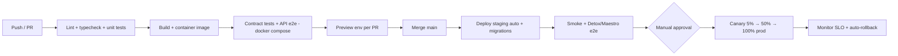

# 06 · Delivery Pipeline & Roadmap — how to build Delyva start → finish

## 1. Phases at a glance

```
Phase 0  Discovery & brand lock        (wks 1–3)
Phase 1  Design (UX/UI/design system)  (wks 2–7)   ← screens in /design are the starting point
Phase 2  Foundations & platform        (wks 4–8)
Phase 3  MVP build in 2-week sprints   (wks 8–24)
Phase 4  Pilot (1 city, 2 hubs)        (wks 22–30)
Phase 5  Launch & scale                (wk 30+)
```

### Phase 0 – Discovery (proposal "Next steps")

1. Secure brand: business name check, trademark, domains (`delyva.ng/.com`), social handles.
2. Validate fleet: e-bike range, load, spare parts.
3. Size first hubs: solar + battery vs fleet & hours.
4. Legal: CAC registration, shareholders' agreement, PSP onboarding (Paystack/Flutterwave KYB), NDPA, insurance.
5. Research: 15 merchant + 15 customer + 10 rider interviews; competitor teardown (Glovo/Chowdeck/Uber Eats/Bolt Food/Jumia Food).
   Outputs: PRD, scope, risk register, KPI tree.

### Phase 1 – Design

Research synthesis → user flows → wireframes → **design system** → hi-fi screens (4 apps) → clickable prototype → usability test (5 users/app) → dev hand-off (Figma + tokens JSON + specs). See docs 07–08.

### Phase 2 – Foundations

Repo (monorepo: pnpm + Turborepo: `apps/{customer,merchant,rider,admin,api}`, `packages/{ui,tokens,api-client,config}`) · CI/CD · environments · auth/OTP · RBAC · DB schema v1 · design tokens → code · observability · PSP sandbox · maps keys · feature flags.

### Phase 3 – MVP build (sprint plan)

| Sprint | Backend                                      | Mobile/Web                                         |
| ------ | -------------------------------------------- | -------------------------------------------------- |
| 1      | Identity, OTP, users, addresses              | Customer shell, auth, onboarding                   |
| 2      | Catalog, merchants, media, search            | Merchant onboarding, menu mgmt; customer discovery |
| 3      | Orders, quote/pricing, cart                  | Cart, checkout UI; merchant orders inbox           |
| 4      | Payments (Paystack), webhooks, ledger v1     | Payment flows; wallet; order states                |
| 5      | Dispatch v1, offers, rider auth/KYC          | Rider onboarding, offers, delivery flow            |
| 6      | Tracking, sockets, ETA, geofence, POD OTP    | Live tracking customer/merchant; rider nav         |
| 7      | Admin APIs, settlements, payouts, refunds    | Admin dashboard (live board, approvals, finance)   |
| 8      | Notifications (push/SMS/WA), support, promos | Ratings, help, promos; polish                      |
| 9      | Fleet/energy basics, reporting               | Fleet screens; rider battery                       |
| 10     | Hardening: load test, security, fraud rules  | Beta fixes, a11y, performance, store listings      |

### Phase 4 – Pilot

Closed beta: 25–50 merchants (Bashir), 15–25 riders, 1 hub, 1–2 zones. Daily review; fix; measure SLAs. Go/no-go gates: on-time ≥ 90 %, cancel ≤ 5 %, payout accuracy 100 %, crash-free ≥ 99.5 %.

### Phase 5 – Launch & scale

Public launch with referral + free-delivery promos (Adam), add hubs by order density, V2 features, new cities.

## 2. Team & roles (lean)

| Role                      | Count | Notes                     |
| ------------------------- | ----- | ------------------------- |
| Product/Tech lead         | 1     | Abdulsamad                |
| UI/UX designer            | 1     | system + 4 apps           |
| Mobile engineers (RN)     | 2     | customer/merchant + rider |
| Backend engineers         | 2     | orders/payments/dispatch  |
| Web engineer              | 1     | admin + merchant web      |
| QA / SDET                 | 1     |                           |
| DevOps (part-time)        | 0.5   |                           |
| Ops/Support lead          | 1     | Nafiu's team              |
| Catalogue/onboarding team | 2–3   | digitise menus            |

## 3. Engineering workflow

- **Trunk-based** with short-lived branches; PR template; 1–2 reviewers; conventional commits; semantic versioning for apps.
- **Definition of Ready:** story with acceptance criteria + design link + API contract.
- **Definition of Done:** tests, a11y check, analytics events, feature flag, docs, QA pass, deployed to staging.
- Rituals: 2-week sprints, daily 10-min stand-up, demo + retro, monthly roadmap review.

## 4. CI/CD pipeline



Mobile: EAS Build → internal track (TestFlight / Play Internal) → staged rollout (5 → 25 → 100 %); OTA (EAS Update) for JS-only hotfixes; min-version gate.
DB: Prisma/Knex migrations, expand-contract pattern, zero-downtime.

## 5. Quality strategy

| Level         | Tools                                                             |
| ------------- | ----------------------------------------------------------------- |
| Unit          | Jest/Vitest, ≥ 80 % on domain (pricing, state machine, ledger)    |
| Integration   | Testcontainers (PG/Redis), PSP mocks                              |
| E2E mobile    | Maestro / Detox on real Android low-end devices                   |
| E2E web       | Playwright                                                        |
| Load          | k6: 500 orders/min, 5k riders pinging                             |
| Chaos/failure | Webhook duplicates, PSP downtime, socket drop, GPS jitter         |
| Security      | SAST, dependency audit, DAST, pen-test pre-launch                 |
| UX            | Usability tests, session replays (PostHog), a11y audits (WCAG AA) |
| Field         | Ride-alongs with riders, merchant shadowing                       |

## 6. Release & ops readiness

Runbooks (payment outage, dispatch stuck, social-media crisis), on-call rota, status page, support macros, merchant & rider training kits, SOP for hub (charging, handover, cash), insurance claim process, T&Cs / privacy / permitted-items pages, app-store assets, customer support WhatsApp line.

## 7. Launch playbook

- T-4 wks: merchant waitlist, referral landing page, influencer seeding (Adam).
- T-2 wks: pilot hub opens, rider training, test orders.
- T-0: launch promos (₦300 delivery, first order free delivery), merchant visibility boost.
- T+2 wks: review KPI, tune pricing & batching; expand zones.

## 8. Risks & mitigations

| Risk                           | Mitigation                                                         |
| ------------------------------ | ------------------------------------------------------------------ |
| E-bike range/charging downtime | Battery-aware dispatch, swap stock, grid backup, small zones first |
| Merchant adoption              | Free signup, assisted upload, field agents, early-partner perks    |
| Payment failures / fraud       | Idempotency, reconciliation, COD caps, device checks               |
| Rider supply & retention       | Fair pay, instant cash-out, bonuses, insurance, hub community      |
| Thin margins                   | Batching, config pricing, commission tiers, sponsored placement    |
| Connectivity                   | Offline queues, SMS fallback, light assets                         |
| Regulatory                     | NDPA, licensed PSPs, legal review of rider classification          |

## 9. Cost buckets (to budget)

People · cloud + maps + SMS/WhatsApp (largest variable: Maps & SMS) · PSP fees · KYC checks · hardware (bikes, batteries, solar, tablets for merchants) · marketing/promos · insurance · legal/compliance.
